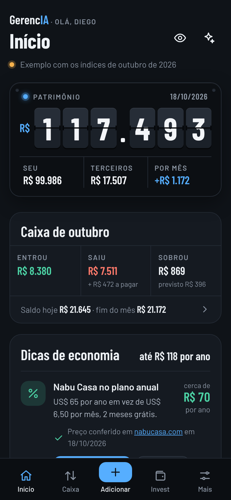
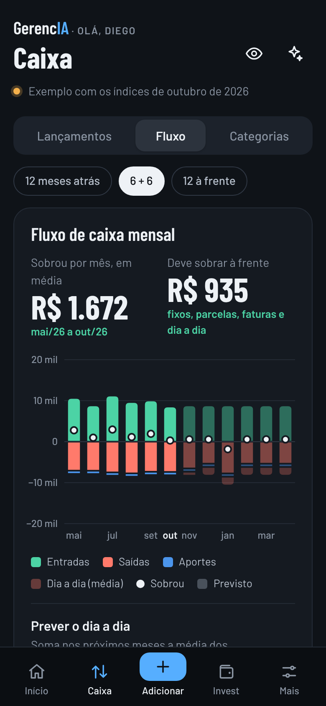
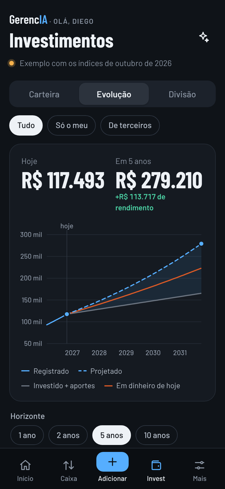
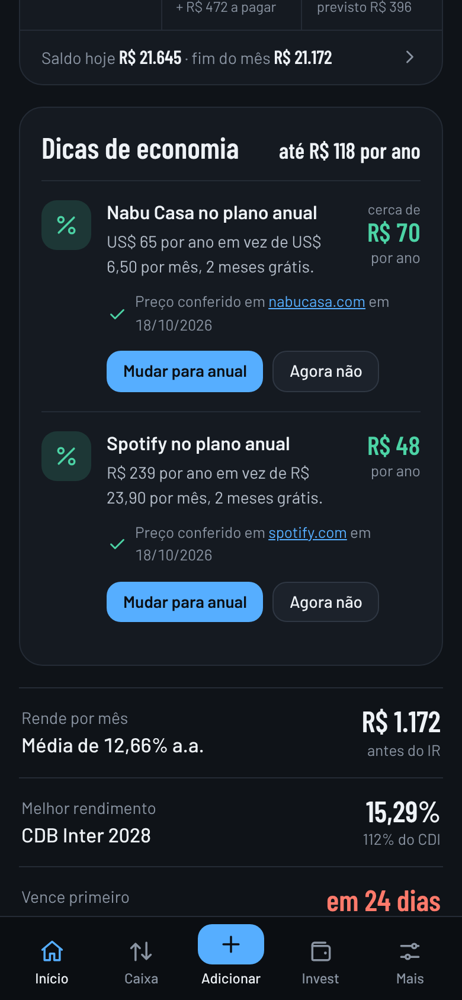

# GerencIA para Home Assistant


Um App do Home Assistant para cuidar do **seu dinheiro**: o **caixa do dia a dia** (recebimentos, despesas, fixos, parcelas e faturas de cartão), os **investimentos** com rendimento no padrão de mercado e quanto eles vão render, e **leitura por IA** de faturas em PDF, prints e mensagens do WhatsApp.

<p align="center">
  
  
  
  
</p>

## Instalação

1. No Home Assistant: **Configurações → Aplicativos → Loja de aplicativos**.
2. No menu **⋮ → Repositórios**, adicione:
   ```
   https://github.com/diegozapella63/gerencia-ha
   ```
3. Procure **GerencIA** na loja, toque em **Instalar** e depois em **Iniciar**.
4. Ative **Mostrar na barra lateral**.

Ou adicione o repositório direto pelo botão:

[](https://my.home-assistant.io/redirect/supervisor_add_addon_repository/?repository_url=https%3A%2F%2Fgithub.com%2Fdiegozapella63%2Fgerencia-ha)

A primeira instalação leva alguns minutos, porque o app é montado no próprio Home Assistant. Depois, as atualizações aparecem sozinhas, com o botão **Atualizar**.

## O que tem

- **Início** com um placar de plaquinhas que viram, como num painel de cotações: patrimônio, seu dinheiro, o de terceiros e quanto rende por mês. Fica escuro ou claro conforme o tema.
- **Caixa do mês**: quanto entrou, quanto saiu, o que falta pagar e o saldo previsto para o fim do mês.
- **Recebimentos e despesas** com categoria, conta e cartão de cada pessoa.
- **Fixos** todo mês ou todo ano, com valor padrão: o salário pode vir maior ou menor num mês sem mudar o padrão.
- **Cartão de crédito**: compras, parcelas e fixos entram no mês em que a fatura vence, também nos gráficos dos próximos meses.
- **Bancos com contas por pessoa**: "Nubank: Diego com cartão (fecha dia 3, vence dia 10) e Dessa com cartão (fecha dia 28, vence dia 5)".
- **Fluxo de caixa** mês a mês, com entradas, saídas, o que sobrou, saldo e previsão do dia a dia.
- **Categorias** de gastos e de recebimentos.
- **Investimentos** com rendimento no padrão de mercado (% do CDI, CDI +, prefixado, IPCA +, Selic +, poupança) e índices do Banco Central.
- **Meu ou de terceiros**: de quem é cada dinheiro, com o total por pessoa.
- **Evolução projetada** de 1 a 10 anos, com aporte mensal, desconto de IR e valor em dinheiro de hoje. O aporte entra no fluxo de caixa todo mês.
- **Leitura por IA**: fatura em PDF, print, foto de papel ou texto do WhatsApp viram lançamentos, e print do banco vira investimento. Você confere tudo antes de lançar.
- **Dicas de economia**: quando uma assinatura tem plano anual mais barato, com o preço conferido na página oficial do serviço.
- **Fotos** em lançamentos e investimentos.
- **Sensores** no Home Assistant: patrimônio, seu dinheiro, de terceiros, rendimento, saldo em caixa, entradas e saídas do mês.
- **Backup** em `share/gerencia`, exportação em CSV, relatório e versões anteriores.

Mais detalhes em [gerencia/DOCS.md](gerencia/DOCS.md).

## Seus dados

Seus lançamentos e investimentos ficam só no seu Home Assistant, em um arquivo aberto (JSON), e entram nos backups do Home Assistant. Este repositório tem apenas o código do app.

## Estrutura

```
repository.yaml               repositório de apps
gerencia/                     o app (config, Dockerfile, ícone, documentação)
gerencia/app/server.py        servidor (só biblioteca padrão do Python)
gerencia/app/calc.py          cálculos de rendimento e de caixa
gerencia/app/assinaturas.py   dicas de economia conferidas na origem
gerencia/app/www/             interface (HTML, CSS e JavaScript, sem etapa de build)
docs/                         imagens deste README
```

## Desenvolvimento

```bash
cd gerencia/app
GERENCIA_DEV=1 GERENCIA_DATA=./.data GERENCIA_SHARE=./.share GERENCIA_MEDIA=./.media \
  python3 server.py                                  # abre em http://127.0.0.1:8099
```

Fora do Home Assistant, `GERENCIA_IA_MOCK=1` simula a IA, `GERENCIA_FONTES_MOCK=<pasta>` usa páginas de preço salvas (`<serviço>.html`) e `GERENCIA_DOLAR=5.04` fixa o dólar.

## Créditos

Fontes [Barlow](https://fonts.google.com/specimen/Barlow) e [Barlow Condensed](https://fonts.google.com/specimen/Barlow+Condensed) (SIL Open Font License). Índices da [API de séries do Banco Central](https://dadosabertos.bcb.gov.br/).
