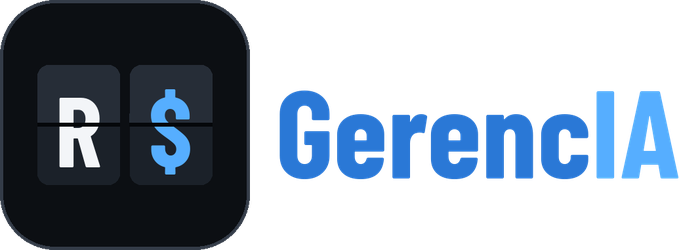
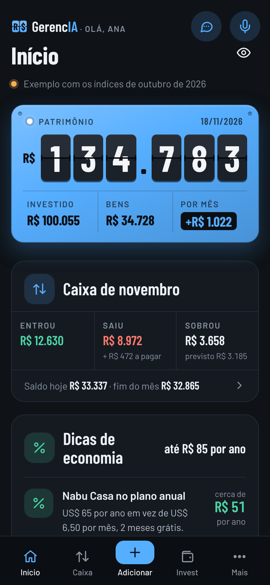
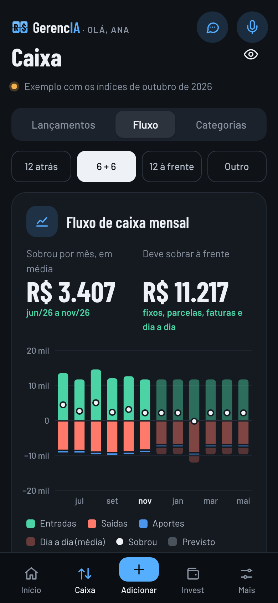
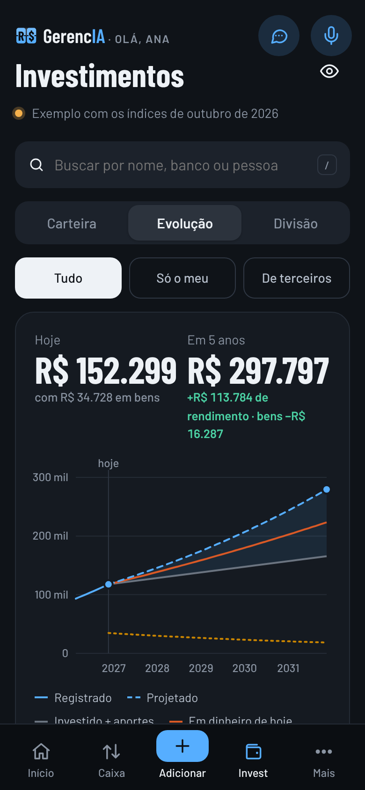
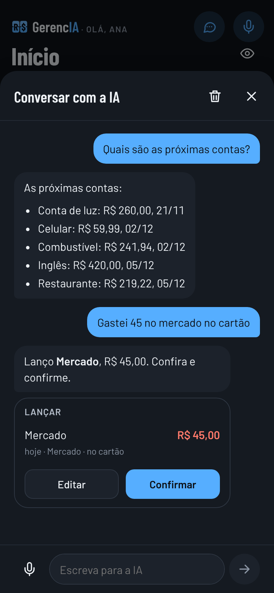

# GerencIA para Home Assistant



Um App do Home Assistant para cuidar do **seu dinheiro**: o **caixa do dia a dia** (recebimentos, despesas, fixos, parcelas e faturas de cartão), os **investimentos** com rendimento no padrão de mercado e quanto eles vão render, os **bens da casa** e a **IA**, que lê faturas em PDF, prints e mensagens do WhatsApp e conversa sobre as suas contas.

<p align="center">
  
  
  
  
</p>

## Instalação

1. No Home Assistant: **Configurações → Aplicativos → Loja de aplicativos**.
2. No menu **⋮ → Repositórios**, adicione:
   ```
   https://github.com/diegozapella63/gerencia-ha
   ```
3. Procure **GerencIA** na loja, toque em **Instalar** e depois em **Iniciar**.
4. Ative **Mostrar na barra lateral**.

Ou adicione o repositório direto pelo botão:

[](https://my.home-assistant.io/redirect/supervisor_add_addon_repository/?repository_url=https%3A%2F%2Fgithub.com%2Fdiegozapella63%2Fgerencia-ha)

A primeira instalação leva alguns minutos, porque o app é montado no próprio Home Assistant. Depois, as atualizações aparecem sozinhas, com o botão **Atualizar**.

## O que tem

- **Início** com um placar de plaquinhas que viram, como num painel de cotações, na cor do app: o seu patrimônio (investimentos e bens) e quanto rende por mês, com o caixa do mês, as dicas e os avisos logo abaixo.
- **Caixa do mês**: quanto entrou, quanto saiu, o que falta pagar e o saldo previsto para o fim do mês.
- **Recebimentos e despesas** com categoria, conta e cartão de cada pessoa.
- **Fixos** todo mês ou todo ano, com valor padrão: o salário pode vir maior ou menor num mês sem mudar o padrão.
- **Salário bruto** com impostos na fonte e descontos (como o plano de saúde), preenchido pelo **Ler recibo** com IA.
- **Cartão de crédito**: compras, parcelas e fixos entram no mês em que a fatura vence, também nos gráficos dos próximos meses.
- **Bancos com contas por pessoa**: "Banco Lua: Ana com cartão (fecha dia 3, vence dia 10) e Beto com cartão (fecha dia 28, vence dia 5)".
- **Fluxo de caixa** mês a mês, com entradas, saídas, o que sobrou, saldo e previsão do dia a dia.
- **Categorias** de gastos e de recebimentos.
- **Investimentos** com rendimento no padrão de mercado (% do CDI, CDI +, prefixado, IPCA +, Selic +, poupança) e índices do Banco Central.
- **Aplicar mais** e **Transferir** entre investimentos, e **Atualizar saldos** de vários de uma vez, por uma lista ou um print.
- **Meu ou de terceiros**: de quem é cada dinheiro, com o total por pessoa.
- **Evolução projetada** de 1 a 50 anos, com desconto de IR e valor em dinheiro de hoje. O aporte por mês vem das contas a pagar do tipo **Aporte**, o compromisso de aplicar todo mês.
- **Bens da casa**: com o [InventarIA](https://github.com/diegozapella63/inventario-ha), os itens entram no patrimônio, perdendo valor por categoria. Um carro ou um imóvel, seu ou de terceiros, entra como investimento do tipo **Bens**.
- **Leitura por IA**: fatura em PDF, print, foto de papel (também pela câmera, no **Digitalizar com IA**) ou texto do WhatsApp viram lançamentos, e print do banco vira investimento. Você confere tudo antes de lançar.
- **Falar**: o microfone no alto de cada tela. Fale os gastos e recebimentos; o Home Assistant transcreve e a IA separa os lançamentos para você conferir.
- **Conversar com a IA**: o balão ao lado do microfone. Pergunte sobre o que está na tela ou sobre o seu dinheiro, ou peça para lançar, pagar uma conta ou atualizar um saldo: a IA mostra e você confirma.
- **Usar IA**: uma chave liga e desliga tudo o que usa IA; o **Uso da IA** mostra as chamadas de cada dia.
- **Dicas de economia**: quando uma assinatura tem plano anual mais barato, com o preço conferido na página oficial do serviço.
- **Oportunidades de investimento**: as taxas do Tesouro Direto e as ofertas dos bancos que você cadastrou (a IA lê a página de ofertas de cada um), comparadas com o que você já tem, com aviso no celular no horário escolhido.
- **Benefícios** dos cartões e planos (salas VIP, créditos, vantagens): quanto ainda resta no período. A IA lê o regulamento, um print ou a página oficial e cadastra.
- **Faturas por e-mail**: com a integração IMAP do Home Assistant, as faturas, recibos e assinaturas em PDF que chegam por e-mail aparecem no Início para conferir. Cada remetente pode virar **Nunca considerar**, **É um fixo** ou **Novo fixo**.
- **PDF com senha**: as senhas das faturas ficam guardadas aqui e abrem as próximas sozinhas.
- **CorrerIA**: com o [CorrerIA](https://github.com/diegozapella63/CorrerIA-ha), as finanças no WhatsApp, no Claude e no Gemini (perguntar, lançar, pagar, atualizar saldos).
- **Imagens** nos investimentos (comprovante, print do banco).
- **Sensores** no Home Assistant, se quiser: patrimônio, seu dinheiro, de terceiros, rendimento, saldo em caixa, entradas e saídas do mês, bens e uso da IA.
- **Contas no CronologIA**: com o [CronologIA](https://github.com/diegozapella63/cronologia-ha) instalado, as contas a pagar e as faturas aparecem na agenda, com o **Paguei** que dá baixa aqui. A ligação é automática.
- **Mais**, um menu: Bancos, Caixa (fixos, categorias e dicas), Invest (índices, oportunidades e perda de valor dos bens), Benefícios, Relatório de patrimônio (com **Baixar PDF**), Configurações e Sobre, na mesma ordem dos outros apps da família.
- **Tema claro e escuro** (escolhido em cada aparelho) e **Cor do dia**: a cor do app muda todo dia, ou fica a que você escolher entre as 12 cores da família.
- **No computador**, uma barra lateral com as seções, os bancos e as pessoas, as telas em duas colunas e as janelas no meio da tela, como nos outros apps.
- **Backup** em `share/gerencia`, exportação em CSV, JSON e ZIP, relatório e versões anteriores.

Mais detalhes em [gerencia/DOCS.md](gerencia/DOCS.md).

## Seus dados

Seus lançamentos e investimentos ficam só no seu Home Assistant, em um arquivo aberto (JSON), e entram nos backups do Home Assistant. Este repositório tem apenas o código do app.

## Estrutura

```
repository.yaml               repositório de apps
gerencia/                     o app (config, Dockerfile, ícone, documentação)
gerencia/app/server.py        servidor (só biblioteca padrão do Python)
gerencia/app/calc.py          cálculos de rendimento e de caixa
gerencia/app/assinaturas.py   dicas de economia conferidas na origem
gerencia/app/integracao.py    contas a pagar para o CronologIA
gerencia/app/bens.py          bens do InventarIA
gerencia/app/voz.py           Falar (fala para texto do Home Assistant)
gerencia/app/chat.py          Conversar com a IA (o que a IA vê, as ações e a conversa guardada)
gerencia/app/oportunidades.py oportunidades de investimento (Tesouro Direto e as ofertas dos bancos)
gerencia/app/beneficios.py    benefícios lidos pela IA
gerencia/app/emails.py        faturas por e-mail (o evento imap_content do Home Assistant)
gerencia/app/pdfsenha.py      abre PDF com senha (só biblioteca padrão)
gerencia/app/pdf.py           o PDF do Relatório de patrimônio
gerencia/app/avisos.py        avisos no celular das pessoas da casa
gerencia/app/ferramentas.py   as ferramentas do CorrerIA
gerencia/app/www/             interface (HTML, CSS e JavaScript, sem etapa de build)
tools/montar_previa.py        gera preview/gerencia-previa.html (o app num arquivo só, com dados de exemplo)
tools/capturas_docs.py        refaz as imagens de docs/ a partir da prévia
tools/versao.py               sobe a versão nos três lugares de uma vez
tools/cobertura.py            roda os testes e mostra a cobertura do servidor e da tela
tests/                        testes unitários, do servidor e visuais
docs/                         imagens deste README
```

## Desenvolvimento

```bash
cd gerencia/app
GERENCIA_DEV=1 GERENCIA_DATA=./.data GERENCIA_SHARE=./.share GERENCIA_MEDIA=./.media \
  python3 server.py                                  # abre em http://127.0.0.1:8099
```

Fora do Home Assistant, `GERENCIA_IA_MOCK=1` simula a IA, `GERENCIA_FONTES_MOCK=<pasta>` usa páginas de preço salvas (`<serviço>.html`) e `GERENCIA_DOLAR=5.04` fixa o dólar.

Testes: `tests/run.sh` (servidor e tela) e `tests/e2e/run.sh` (visuais) (ver [tests/README.md](tests/README.md)). Como trabalhar no projeto (checklist de cada mudança, versão, testes e como os apps conversam): [AGENTS.md](AGENTS.md).

## Créditos

Fontes [Barlow](https://fonts.google.com/specimen/Barlow) e [Barlow Condensed](https://fonts.google.com/specimen/Barlow+Condensed) (SIL Open Font License). Índices da [API de séries do Banco Central](https://dadosabertos.bcb.gov.br/).
